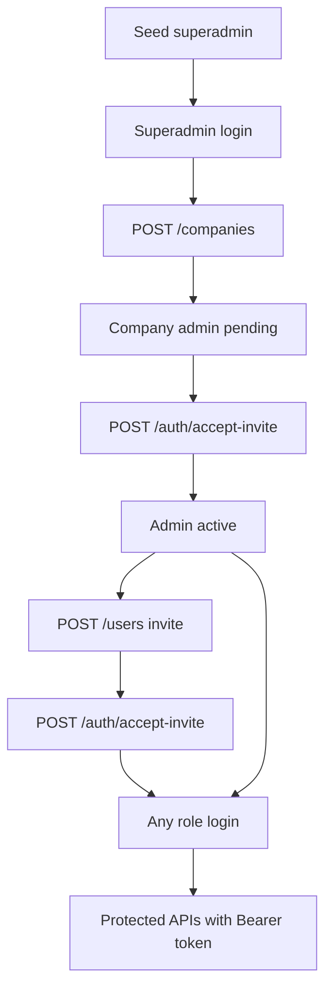

# BizFlow API — Frontend Integration Guide

This guide is for developers integrating the React client with the backend **auth**, **superadmin company management**, and **admin user-management** APIs. The backend uses **short-lived JWT access tokens** plus **httpOnly refresh-token cookies**.

---

## Table of contents

1. [User management flow](#user-management-flow)
2. [Architecture overview](#architecture-overview)
3. [Prerequisites](#prerequisites)
4. [API base URL & CORS](#api-base-url--cors)
5. [Response format](#response-format)
6. [Auth endpoints](#auth-endpoints)
7. [Companies endpoints (superadmin)](#companies-endpoints-superadmin)
8. [Companies backend readiness](#companies-backend-readiness)
9. [Users endpoints (admin)](#users-endpoints-admin)
10. [Role & status rules](#role--status-rules)
11. [Token & cookie rules](#token--cookie-rules)
12. [Client integration checklist](#client-integration-checklist)
13. [Recommended code changes](#recommended-code-changes)
14. [App bootstrap flow](#app-bootstrap-flow)
15. [Automatic token refresh (401 interceptor)](#automatic-token-refresh-401-interceptor)
16. [Error codes reference](#error-codes-reference)
17. [Testing](#testing)
18. [Common pitfalls](#common-pitfalls)
19. [Files reference](#files-reference)

---

## User management flow

This is the **primary flow** the backend is built for:

```
npm run seed
    └── Creates superadmin@bizflow.com (active, no company)

Superadmin logs in
    └── POST /auth/login

Superadmin creates company + company admin
    └── POST /companies  →  Company + pending admin user
    └── Optional invite email (sendInviteEmail) with link to set password

Company admin accepts invite
    └── POST /auth/accept-invite  →  active, can log in

Company admin creates staff
    └── POST /users  →  manager or employee (pending, invite-only)
    └── POST /auth/accept-invite  →  each user sets password

All roles log in
    └── POST /auth/login  →  access token + refresh cookie
    └── GET /auth/me, POST /auth/refresh, POST /auth/logout
```



**Self-registration (`POST /auth/register`) has been removed.** All accounts are provisioned by superadmin (company admins) or company admin (managers/employees). Onboarding is **invite-only** — no temporary passwords.

---

## Architecture overview

```
┌─────────────┐     accessToken (JSON body)      ┌─────────────┐
│  React app  │ ◄──────────────────────────────► │  Express    │
│             │     Authorization: Bearer …      │  /api/v1    │
│  memory     │                                  │             │
└─────────────┘     refreshToken (httpOnly       └─────────────┘
       │             cookie, auto-sent)                  │
       │                                                 ▼
       │                                          MongoDB
       └──── POST /auth/refresh (no Bearer needed)
```

| Token | Lifetime (default) | Where it lives | Used for |
|-------|-------------------|----------------|----------|
| **Access token** | 15 minutes (`JWT_ACCESS_EXPIRES_IN`) | Client memory (recommended) | `Authorization: Bearer` on API calls |
| **Refresh token** | 7 days (`JWT_REFRESH_EXPIRES_IN`) | httpOnly cookie (`refreshToken`) | `POST /auth/refresh` only |

**Important:** The refresh token is **never** returned in the JSON body. The browser stores it automatically from `Set-Cookie`.

---

## Prerequisites

### 1. Start the backend

```bash
cd server
cp .env.example .env   # if .env does not exist
npm install
npm run seed           # creates the initial superadmin account (idempotent)
npm run dev            # http://localhost:5000
```

Verify: `GET http://localhost:5000/health` → `{ "success": true, "data": { "status": "ok", ... } }`

### 2. Initial superadmin account (after seed)

| Email | Password | Role | Status | companyId |
|-------|----------|------|--------|-----------|
| `superadmin@bizflow.com` | `SuperAdmin123!` | superadmin | active | `null` |

Only the **superadmin** is seeded. Company admins are created via `POST /companies`. Managers and employees are created by the company admin via `POST /users`.

### 3. Server environment variables

| Variable | Default | Purpose |
|----------|---------|---------|
| `PORT` | `5000` | API port |
| `MONGODB_URI` | — | MongoDB connection |
| `JWT_SECRET` | — | Access token signing (min 16 chars) |
| `JWT_ACCESS_EXPIRES_IN` | `15m` | Access token TTL |
| `JWT_REFRESH_EXPIRES_IN` | `7d` | Refresh token DB expiry |
| `REFRESH_TOKEN_COOKIE_NAME` | `refreshToken` | Cookie name |
| `COOKIE_SECURE` | `false` | Set `true` in production (HTTPS) |
| `COOKIE_SAME_SITE` | `lax` | Cookie SameSite policy |
| `CORS_ORIGIN` | `http://localhost:5173` | Must match frontend origin exactly |
| `APP_URL` | `http://localhost:5173` | Base URL for invite/reset email links |
| `SMTP_HOST` | — | Optional; links logged to console when unset |
| `SMTP_PORT` | `587` | SMTP port |
| `SMTP_USER` | — | SMTP username |
| `SMTP_PASS` | — | SMTP password |
| `MAIL_FROM` | — | Sender email address |
| `INVITE_TOKEN_EXPIRES_HOURS` | `72` | Invite link TTL |
| `RESET_TOKEN_EXPIRES_HOURS` | `24` | Password reset link TTL |

---

## API base URL & CORS

**Option A — Vite proxy (recommended for local dev)**

Add to `client/vite.config.ts`:

```ts
export default defineConfig({
  // ...existing config
  server: {
    proxy: {
      '/api': 'http://localhost:5000',
    },
  },
})
```

Then use relative URLs in the client:

```ts
const API_BASE = '/api/v1'
```

Cookies work more reliably because requests appear same-origin to the browser.

**Option B — Direct cross-origin**

```ts
const API_BASE = 'http://localhost:5000/api/v1'
```

Requirements:
- Server `CORS_ORIGIN` must exactly match the client origin (e.g. `http://localhost:5173`)
- Every `fetch` must include `credentials: 'include'`
- Server already sets `credentials: true` in CORS config

---

## Response format

All API responses use a consistent envelope.

### Success

```json
{
  "success": true,
  "data": { /* payload */ },
  "message": "optional string"
}
```

### Error

```json
{
  "success": false,
  "error": {
    "message": "Human-readable message",
    "code": "ERROR_CODE",
    "details": { /* optional, e.g. validation fields */ }
  }
}
```

The current client `apiRequest` in `client/src/shared/api/client.ts` does **not** parse this envelope yet. Integration must unwrap `data` on success and `error` on failure.

---

## Auth endpoints

Base path: `/api/v1/auth`

All auth routes are rate-limited to **20 requests per 15 minutes** per IP.

### `POST /login`

Authenticates any role (admin, manager, employee). Returns access token in body; sets refresh cookie.

**Request body:**

```json
{
  "email": "admin@bizflow.com",
  "password": "Admin123!",
  "rememberMe": true
}
```

| Field | Type | Notes |
|-------|------|-------|
| `email` | string | required |
| `password` | string | required |
| `rememberMe` | boolean | optional, default `false`. `true` → cookie lasts 30 days |

**Success `200`:**

```json
{
  "success": true,
  "data": {
    "user": {
      "id": "…",
      "email": "admin@bizflow.com",
      "fullName": "John Doe",
      "role": "admin",
      "status": "active"
    },
    "accessToken": "eyJhbGciOiJIUzI1NiIs..."
  }
}
```

**Response headers:**

```
Set-Cookie: refreshToken=<opaque-token>; Path=/api/v1/auth; HttpOnly; SameSite=Lax
```

**Errors:** `401 INVALID_CREDENTIALS`, `400 VALIDATION_ERROR`

---

### `POST /refresh`

Issues a new access token. Uses the httpOnly cookie — **no Bearer token required**.

**Request body:** empty

**Must include:** `credentials: 'include'` so the browser sends the cookie.

**Success `200`:**

```json
{
  "success": true,
  "data": {
    "user": { /* AuthUser */ },
    "accessToken": "eyJhbGciOiJIUzI1NiIs..."
  }
}
```

A new `Set-Cookie` is returned (token rotation).

**Errors:** `401 INVALID_REFRESH_TOKEN`, `401 REFRESH_TOKEN_EXPIRED`, `401 REFRESH_TOKEN_REUSE`

---

### `POST /logout`

Revokes the refresh token and clears the cookie.

**Request body:** empty

**Must include:** `credentials: 'include'`

**Success `200`:**

```json
{
  "success": true,
  "data": { "message": "Logged out successfully" }
}
```

**Client note:** Also clear the in-memory access token on the client.

---

### `GET /me`

Returns the current user. Requires a valid access token.

**Headers:**

```
Authorization: Bearer <accessToken>
```

**Success `200`:**

```json
{
  "success": true,
  "data": {
    "user": {
      "id": "…",
      "email": "admin@bizflow.com",
      "fullName": "John Doe",
      "role": "admin",
      "status": "active"
    }
  }
}
```

**Errors:** `401 UNAUTHORIZED`, `401 TOKEN_EXPIRED`, `401 INVALID_TOKEN`, `404 USER_NOT_FOUND`

---

### `POST /accept-invite`

Activates a pending user by setting their password. Used for company admins and staff after receiving an invite email.

**Request body:**

```json
{
  "token": "<invite-token-from-email>",
  "password": "Secure123!",
  "confirmPassword": "Secure123!"
}
```

**Success `200`:** Returns `user` with `status: active`.

**Errors:** `400 INVALID_TOKEN`, `400 TOKEN_EXPIRED`, `400 VALIDATION_ERROR`

---

### `POST /forgot-password`

Sends a password reset email if the account exists and is active. Always returns success (no email enumeration).

**Request body:** `{ "email": "user@company.com" }`

---

### `POST /reset-password`

**Request body:**

```json
{
  "token": "<reset-token-from-email>",
  "password": "NewSecure123!",
  "confirmPassword": "NewSecure123!"
}
```

**Success `200`:** `{ "message": "Password reset successfully" }`

---

## Companies endpoints (superadmin)

Base path: `/api/v1/companies`

**All routes require:** `Authorization: Bearer <accessToken>` from a **superadmin** account (`role: superadmin`, no `companyId`).

Middleware stack: `protect` → `requireActive` → `authorize('superadmin')`

Company admins, managers, HR, and employees receive `403 FORBIDDEN` on every `/companies` route.

### `POST /companies` — Create company + admin

Atomically creates a `Company` document and a **pending** company `admin` user. Rolls back both if either step fails.

**Request body** (matches `client/src/features/platform/model/schemas.ts` → `companyFormSchema`):

```json
{
  "companyName": "Amazigh Innovations",
  "email": "info@company.com",
  "phone": "+92 300 1234567",
  "phoneSecondary": "+92 300 7654321",
  "subscriptionPlan": "basic",
  "startAs": "active",
  "adminFullName": "Naeem",
  "adminEmail": "naeem@company.com",
  "sendInviteEmail": true,
  "country": "pakistan",
  "city": "Lahore",
  "addressLine": "123 Main St",
  "postalCode": "54000",
  "primaryColor": "#00284F",
  "secondaryColor": "#136DEC",
  "timezone": "gmt+5",
  "currency": "pkr",
  "dateFormat": "DD/MM/YYYY",
  "logoUrl": "https://example.com/logo.png"
}
```

| Field | Rules |
|-------|-------|
| `companyName` | Required |
| `email` | Valid company contact email (not uniqueness-checked) |
| `phone` | Required |
| `phoneSecondary` | Optional |
| `subscriptionPlan` | `basic`, `pro`, or `enterprise` |
| `startAs` | Initial company `status`: `active`, `trial`, or `inactive` |
| `adminFullName`, `adminEmail` | Required; admin email must be globally unique |
| `sendInviteEmail` | When `true`, sends invite email and returns `devInviteToken` in development |
| Address/branding fields | `country`, `city`, `addressLine`, `postalCode`, `primaryColor`, `secondaryColor`, `timezone`, `currency`, `dateFormat` — all required |
| `logoUrl` | Optional valid URL |
| `users`, `userLimit`, `rating` | Optional overrides; `userLimit` defaults from plan if omitted (basic=25, pro=50, enterprise=100) |

**Success `201`:**

```json
{
  "success": true,
  "data": {
    "company": {
      "id": "…",
      "name": "Amazigh Innovations",
      "email": "info@company.com",
      "phone": "+92 300 1234567",
      "subscriptionPlan": "basic",
      "status": "active",
      "adminUserId": "…",
      "createdAt": "2026-07-01T12:00:00.000Z",
      "country": "pakistan",
      "city": "Lahore",
      "addressLine": "123 Main St",
      "postalCode": "54000",
      "primaryColor": "#00284F",
      "secondaryColor": "#136DEC",
      "timezone": "gmt+5",
      "currency": "pkr",
      "dateFormat": "DD/MM/YYYY",
      "admin": {
        "id": "…",
        "email": "naeem@company.com",
        "fullName": "Naeem",
        "status": "pending"
      }
    },
    "devInviteToken": "…"
  },
  "message": "Company created successfully"
}
```

`devInviteToken` is only present when `NODE_ENV=development` and `sendInviteEmail` is `true`. Use it with `POST /auth/accept-invite` when SMTP is not configured.

**Errors:** `409 DUPLICATE_EMAIL` (admin email taken), `400 VALIDATION_ERROR`, `403 FORBIDDEN` (non-superadmin)

---

### `GET /companies` — List companies (paginated)

**Query parameters:**

| Param | Type | Default | Notes |
|-------|------|---------|-------|
| `page` | number | `1` | Min 1 |
| `limit` | number | `20` | Max 100 |
| `status` | string | — | `active`, `trial`, or `inactive` |
| `search` | string | — | Case-insensitive match on `name`, `email`, or `subscriptionPlan` |
| `rating` | number | — | Minimum rating (`rating >= value`); `all` or empty string is ignored |

Sort is fixed server-side: `createdAt` descending (no `sort` query param).

**Examples:**
- `GET /companies` — first page
- `GET /companies?status=trial&page=1&limit=10`
- `GET /companies?search=amazigh&rating=4`

**Success `200`:**

```json
{
  "success": true,
  "data": {
    "companies": [
      {
        "id": "…",
        "name": "Amazigh Innovations",
        "plan": "basic",
        "users": 0,
        "userLimit": 25,
        "status": "active",
        "rating": 0,
        "actionVariant": "edit"
      }
    ],
    "pagination": {
      "page": 1,
      "limit": 20,
      "total": 1,
      "totalPages": 1
    }
  }
}
```

`actionVariant` is computed server-side for table row actions:

| Company `status` | `actionVariant` |
|------------------|-----------------|
| `inactive` | `reactivate` |
| `trial` | `view` |
| `active` | `edit` |

**Note:** List rows use `plan`; detail responses use `subscriptionPlan`. Map in the client if you use a single type.

---

### `GET /companies/stats` — Platform dashboard stats

Returns aggregate counts for the superadmin dashboard. **Not** scoped to the current page of the list.

**Success `200`:**

```json
{
  "success": true,
  "data": {
    "stats": {
      "totalCompanies": 24,
      "activeCompanies": 18,
      "trialCompanies": 4,
      "inactiveCompanies": 2,
      "licensedUsers": 1200,
      "activeUsers": 340,
      "platformRevenue": 2850
    }
  }
}
```

| Field | Meaning |
|-------|---------|
| `licensedUsers` | Sum of all companies' `userLimit` |
| `activeUsers` | Sum of all companies' `users` field (stored counter, not live user count) |
| `platformRevenue` | Estimated monthly revenue from non-inactive companies (basic=$29, pro=$99, enterprise=$299 per company) |

---

### `GET /companies/:id` — Company detail

**Success `200`:**

```json
{
  "success": true,
  "data": {
    "company": {
      "id": "…",
      "name": "Amazigh Innovations",
      "email": "info@company.com",
      "phone": "+92 300 1234567",
      "phoneSecondary": "+92 300 7654321",
      "subscriptionPlan": "basic",
      "status": "active",
      "adminUserId": "…",
      "createdAt": "2026-07-01T12:00:00.000Z",
      "country": "pakistan",
      "city": "Lahore",
      "addressLine": "123 Main St",
      "postalCode": "54000",
      "logoUrl": "https://example.com/logo.png",
      "primaryColor": "#00284F",
      "secondaryColor": "#136DEC",
      "timezone": "gmt+5",
      "currency": "pkr",
      "dateFormat": "DD/MM/YYYY",
      "admin": {
        "id": "…",
        "email": "naeem@company.com",
        "fullName": "Naeem",
        "status": "active"
      }
    }
  }
}
```

**Errors:** `404 COMPANY_NOT_FOUND`, `404 USER_NOT_FOUND` (linked admin missing)

---

### `POST /companies/:id/resend-invite` — Resend admin invite

Re-sends the invite email to the company's linked admin. Only valid when that user has `role: admin` and `status: pending`.

**Success `200`:**

```json
{
  "success": true,
  "data": {
    "devInviteToken": "…"
  },
  "message": "Invitation email sent"
}
```

`devInviteToken` only in development.

**Errors:** `400 INVITE_NOT_PENDING` (admin already active), `404 COMPANY_NOT_FOUND`, `404 USER_NOT_FOUND`

---

### API ↔ client type mapping

The superadmin UI (`client/src/features/platform/`) was built against mock data. When wiring real APIs, map backend shapes to UI types or simplify the UI to match the API.

| UI field (`CompanyDetail`) | API field | Notes |
|----------------------------|-----------|-------|
| `plan` | `subscriptionPlan` | List uses `plan` already |
| `adminId` | `admin.id` or `adminUserId` | |
| `adminName` | `admin.fullName` | |
| `joinDate` / `joiningDate` | `createdAt` | Format for display in client |
| `employees` | — | Use `users` from list row, or add backend field later |
| `industry`, `workLocation`, `employeeAvatars`, `adminAvatar` | — | **Not in API** — remove from UI or show placeholders |

The list type `Company` in `client/src/features/platform/model/types.ts` already aligns with `GET /companies` row shape.

---

## Companies backend readiness

Assessment for integrating the **superadmin** client (`/companies`, `/dashboard`, `/companies/new`, etc.).

### Ready to integrate now

| Capability | Endpoint | Client page |
|------------|----------|-------------|
| Create company + admin | `POST /companies` | `AddCompanyPage` |
| Paginated list + filters | `GET /companies` | `CompaniesPage`, `CompaniesTable` |
| Company detail | `GET /companies/:id` | `CompanyDetailPage` |
| Dashboard stats | `GET /companies/stats` | `SuperAdminDashboardPage` stat cards |
| Resend admin invite | `POST /companies/:id/resend-invite` | Add to detail page when admin is `pending` |

Auth is already wired (`apiClient` + `AuthContext`). The companies module (`client/src/features/platform/api/companiesApi.ts`) is still a **stub** — replace it with real `apiClient` calls.

### Not implemented on backend (UI exists but cannot wire yet)

| Capability | UI location | Gap |
|------------|-------------|-----|
| Edit company | `EditCompanyPage`, `EditCompanyForm` | No `PATCH /companies/:id` |
| Suspend company | `CompaniesTable` suspend action | No status-update endpoint |
| Reactivate company | `CompaniesTable` reactivate action | No status-update endpoint |
| Delete company | `PlatformActionCards` | No `DELETE /companies/:id` |
| Change company admin | — | Admin is fixed at create time |
| Subscription billing | `/subscriptions/*` pages | No subscription entity beyond `subscriptionPlan` on company |

**Minimum backend work for full CRUD parity with the users module:** add `PATCH /companies/:id` (profile, plan, branding, `status` transitions) and optionally `DELETE /companies/:id`.

### Data caveats

- **`company.users`** is a stored counter, not a live count of users in MongoDB. It is not incremented when the company admin creates staff via `POST /users`. Dashboard `activeUsers` may be stale unless you sync the counter or compute from users collection.
- **Company `email`** is not unique — only `adminEmail` is checked on create.
- **Plan user limits** are set automatically on save: basic=25, pro=50, enterprise=100 (`server/src/features/companies/company.model.ts`).

### Recommended integration order

1. Replace `companiesApi.create` with `apiClient.post('/companies', values)` — form schema already matches validation.
2. Add `list`, `getById`, `getStats`, `resendInvite` to `companiesApi`.
3. Add React Query hooks; invalidate list/stats after create.
4. Swap `mockCompanies` / `mockCompanyDetails` in pages for hook data.
5. Use server pagination (`page`, `limit`) instead of client-side `filterCompanies()`.
6. Wire `GET /companies/stats` into dashboard widgets.
7. Add resend-invite button on detail when `company.admin.status === 'pending'`.
8. Defer edit/suspend/delete until backend endpoints exist.

---

## Users endpoints (admin)

Base path: `/api/v1/users`

**All routes require:** `Authorization: Bearer <accessToken>` from a **company admin** account (`role: admin` with a `companyId`). Superadmin cannot access `/users`.

Middleware stack: `protect` → `requireActive` → `authorize('admin')`

Non-admin roles receive `403 FORBIDDEN`.

### `POST /users` — Create user (invite-only)

Company admin creates a manager or employee. User is **`pending`** until they accept the invite and set a password.

**Request body:**

```json
{
  "fullName": "Sarah Khan",
  "email": "sarah@company.com",
  "role": "manager",
  "sendInviteEmail": true
}
```

| Field | Rules |
|-------|-------|
| `fullName` | min 2 characters |
| `email` | valid, unique globally |
| `role` | `manager` or `employee` only |
| `sendInviteEmail` | boolean, default `true` |

**Success `201`:** Returns `user` with `status: pending`. In development, may include `devInviteToken` when invite email is sent.

**Errors:** `409 DUPLICATE_EMAIL`, `400 VALIDATION_ERROR`, `403 FORBIDDEN`

**Note:** No tokens are returned. The new user must call `POST /auth/accept-invite` then log in via `POST /auth/login`.

### `POST /users/:id/resend-invite` — Resend staff invite

Only when the user is still `pending`.

---

### `GET /users` — List users

**Query parameters:**

| Param | Type | Example |
|-------|------|---------|
| `page` | number | `1` (default) |
| `limit` | number | `20` (default, max 100) |
| `role` | string | `admin`, `manager`, `employee` |
| `status` | string | `active`, `pending` |
| `search` | string | matches `email` or `fullName` |

**Examples:**
- `GET /users` — all users, paginated
- `GET /users?role=manager`
- `GET /users?search=sarah&page=1&limit=10`

**Success `200`:**

```json
{
  "success": true,
  "data": {
    "users": [
      {
        "id": "…",
        "email": "sarah@company.com",
        "fullName": "Sarah Khan",
        "role": "manager",
        "status": "active"
      }
    ],
    "pagination": {
      "page": 1,
      "limit": 20,
      "total": 3,
      "totalPages": 1
    }
  }
}
```

---

### `GET /users/:id` — Get one user

**Success `200`:** `{ "user": { /* AuthUser */ } }`

**Errors:** `404 USER_NOT_FOUND`, `403 FORBIDDEN`

---

### `PATCH /users/:id` — Update user

**Request body (at least one field):**

```json
{
  "fullName": "Sarah Khan Updated",
  "role": "employee",
  "status": "active"
}
```

**Rules:**
- Cannot modify **admin** accounts (`400 CANNOT_MODIFY_ADMIN`)
- `role` must be `manager` or `employee` (cannot assign `admin`)

**Success `200`:** `{ "user": { /* updated AuthUser */ } }`

---

### `DELETE /users/:id` — Delete user

**Rules:**
- Cannot delete your own account (`400 CANNOT_DELETE_SELF`)
- Cannot delete the last admin (`400 CANNOT_DELETE_ADMIN`)
- Revokes all refresh tokens for the deleted user

**Success `200`:** `{ "message": "User deleted successfully" }`

---

## Role & status rules

| Role | How created | Default status | Can access `/users`? | Can access `/companies`? |
|------|-------------|----------------|----------------------|--------------------------|
| `superadmin` | Seed only | `active` | No (`403`) | Yes |
| `admin` | Superadmin `POST /companies` | `pending` → `active` after invite | Yes (own company) | No (`403`) |
| `manager` | Admin `POST /users` | `pending` → `active` after invite | No (`403`) | No |
| `employee` | Admin `POST /users` | `pending` → `active` after invite | No (`403`) | No |

Pending users cannot log in (`403 ACCOUNT_PENDING`). All roles use the same session endpoints after activation.

---

## Token & cookie rules

### What the client must do

| Action | Access token | Refresh cookie |
|--------|-------------|----------------|
| Login | Save in memory | Browser stores automatically |
| API calls | `Authorization: Bearer` header | Not needed |
| App load / page refresh | Call `POST /refresh` first | Sent automatically with `credentials: 'include'` |
| Logout | Clear from memory | Cleared by server `Set-Cookie` |
| Admin `POST /users` | Admin's Bearer token | Not needed |

### What NOT to do

- Do **not** store the refresh token in `localStorage` or read it from JS (it is httpOnly).
- Do **not** put the access token in the refresh cookie.
- Do **not** call `/refresh` with a Bearer token — it uses the cookie only.

### Cookie path

The refresh cookie path is `/api/v1/auth`. The browser only sends it to URLs under that path.

---

## Client integration checklist

### Auth (all roles)

- [ ] **1.** Choose API base URL (Vite proxy or `VITE_API_URL` env var)
- [ ] **2.** Update `client/src/shared/api/client.ts` — add `credentials: 'include'`, parse `{ success, data, error }` envelope
- [ ] **3.** Create `client/src/features/auth/lib/auth-token.ts` — in-memory access token store
- [ ] **4.** Replace mock `client/src/features/auth/api/authApi.ts` with real HTTP calls
- [ ] **5.** Update `client/src/features/auth/lib/auth-storage.ts` — stop persisting `accessToken` to `localStorage`
- [ ] **6.** Update `client/src/features/auth/model/AuthContext.tsx` — bootstrap via `/refresh`, async logout, loading state
- [ ] **7.** Add 401 interceptor for automatic token refresh

### User management (admin UI)

- [ ] **8.** Create `client/src/features/users/api/usersApi.ts` — wrap `POST/GET/PATCH/DELETE /users`
- [ ] **9.** Wire admin "Add User" form to `POST /users`
- [ ] **10.** Wire user list page to `GET /users` with pagination/filters
- [ ] **11.** Handle `403 FORBIDDEN` if non-admin hits user routes

### Company management (superadmin UI)

- [ ] **12.** Replace stub `client/src/features/platform/api/companiesApi.ts` with real `apiClient` calls
- [ ] **13.** Wire `AddCompanyPage` to `POST /companies`; navigate to `/companies/:id` on success
- [ ] **14.** Wire `CompaniesPage` / `CompaniesTable` to `GET /companies` (server pagination + filters)
- [ ] **15.** Wire `CompanyDetailPage` to `GET /companies/:id`; map API fields to UI (see [API ↔ client type mapping](#api--client-type-mapping))
- [ ] **16.** Wire `SuperAdminDashboardPage` stats to `GET /companies/stats`
- [ ] **17.** Add resend-invite action when `company.admin.status === 'pending'` → `POST /companies/:id/resend-invite`
- [ ] **18.** Remove or gate mock data (`companiesData.ts`, `companyDetailData.ts`, dashboard mocks) once hooks are live
- [ ] **19.** Handle `403 FORBIDDEN` if non-superadmin hits `/companies` (should not happen with `RoleGuard`)
- [ ] **20.** Defer `EditCompanyPage` and suspend/delete actions until `PATCH` / `DELETE` endpoints exist (see [Companies backend readiness](#companies-backend-readiness))

---

## Recommended code changes

### 1. Environment variable

`client/.env`:

```env
VITE_API_URL=/api/v1
```

### 2. API envelope types

```ts
// client/src/shared/api/types.ts
export type ApiEnvelope<T> =
  | { success: true; data: T; message?: string }
  | { success: false; error: { message: string; code?: string; details?: unknown } }
```

### 3. In-memory access token

```ts
// client/src/features/auth/lib/auth-token.ts
let accessToken: string | null = null

export function getAccessToken() {
  return accessToken
}

export function setAccessToken(token: string | null) {
  accessToken = token
}
```

### 4. `authApi.ts`

```ts
const AUTH_BASE = `${import.meta.env.VITE_API_URL ?? '/api/v1'}/auth`

export const authApi = {
  async login(credentials) { /* POST /auth/login */ },
  async refresh() { /* POST /auth/refresh, credentials: 'include' */ },
  async logout() { /* POST /auth/logout */ },
  async me() { /* GET /auth/me */ },
  async register(payload) { /* POST /auth/register — optional */ },
}
```

### 5. `usersApi.ts` (admin)

```ts
const USERS_BASE = `${import.meta.env.VITE_API_URL ?? '/api/v1'}/users`

export const usersApi = {
  async createUser(payload: {
    fullName: string
    email: string
    password: string
    role: 'manager' | 'employee'
  }) { /* POST /users */ },

  async listUsers(params?: {
    page?: number
    limit?: number
    role?: string
    status?: string
    search?: string
  }) { /* GET /users?... */ },

  async getUser(id: string) { /* GET /users/:id */ },

  async updateUser(id: string, payload: Partial<{
    fullName: string
    role: 'manager' | 'employee'
    status: 'active' | 'pending'
  }>) { /* PATCH /users/:id */ },

  async deleteUser(id: string) { /* DELETE /users/:id */ },
}
```

All `usersApi` calls use the shared `apiClient` which attaches `Authorization: Bearer` automatically.

### 6. `companiesApi.ts` (superadmin)

```ts
import { apiClient } from '@/shared/api/axios'
import type { CompanyFormValues } from '@/features/platform/model/schemas'

export type CompanyRow = {
  id: string
  name: string
  plan: string
  users: number
  userLimit: number
  status: string
  rating: number
  actionVariant: 'view' | 'edit' | 'reactivate' | 'suspend'
}

export type CompanyDetail = {
  id: string
  name: string
  email: string
  phone: string
  phoneSecondary?: string
  subscriptionPlan: string
  status: string
  adminUserId: string
  createdAt: string
  country: string
  city: string
  addressLine: string
  postalCode: string
  logoUrl?: string
  primaryColor: string
  secondaryColor: string
  timezone: string
  currency: string
  dateFormat: string
  admin: { id: string; email: string; fullName: string; status: string }
}

export const companiesApi = {
  async create(values: CompanyFormValues) {
    const { data } = await apiClient.post<{
      company: CompanyDetail
      devInviteToken?: string
    }>('/companies', values)
    return data
  },

  async list(params?: {
    page?: number
    limit?: number
    status?: string
    search?: string
    rating?: number | 'all'
  }) {
    const { data } = await apiClient.get<{
      companies: CompanyRow[]
      pagination: { page: number; limit: number; total: number; totalPages: number }
    }>('/companies', { params })
    return data
  },

  async getStats() {
    const { data } = await apiClient.get<{
      stats: {
        totalCompanies: number
        activeCompanies: number
        trialCompanies: number
        inactiveCompanies: number
        licensedUsers: number
        activeUsers: number
        platformRevenue: number
      }
    }>('/companies/stats')
    return data.stats
  },

  async getById(id: string) {
    const { data } = await apiClient.get<{ company: CompanyDetail }>(`/companies/${id}`)
    return data.company
  },

  async resendInvite(id: string) {
    const { data } = await apiClient.post<{ devInviteToken?: string }>(
      `/companies/${id}/resend-invite`,
    )
    return data
  },
}
```

Use React Query for caching and invalidation, e.g. invalidate `['companies']` and `['companies', 'stats']` after `create`.

### 7. `AuthContext.tsx` bootstrap

```ts
useEffect(() => {
  authApi
    .refresh()
    .then((next) => {
      setAccessToken(next.accessToken)
      setSession(next)
    })
    .catch(() => {
      setAccessToken(null)
      setSession(null)
    })
    .finally(() => setIsLoading(false))
}, [])
```

Show a loading spinner while `isLoading` is true.

---

## App bootstrap flow

```
App mounts
    │
    ▼
POST /auth/refresh  (cookie sent automatically)
    │
    ├─ 200 → store accessToken + user → render app
    │
    └─ 401 → no session → render guest routes (login)
```

**Admin creates a user:**

```
POST /users  (admin Bearer token)
    │
    └─ new user created (active) — no session issued

New user logs in separately:
POST /auth/login  →  { user, accessToken } + refresh cookie
```

---

## Automatic token refresh (401 interceptor)

When any protected API call returns `401` with code `TOKEN_EXPIRED`:

```
1. Call POST /auth/refresh (single in-flight promise)
2. On success → update accessToken, retry original request once
3. On failure → clear session, redirect to /login
```

**Do not** retry `/auth/refresh` itself if it returns 401.

---

## Error codes reference

### Auth

| Code | HTTP | When | Client action |
|------|------|------|---------------|
| `INVALID_CREDENTIALS` | 401 | Wrong email/password | Show error message |
| `DUPLICATE_EMAIL` | 409 | Email already exists | Show error |
| `VALIDATION_ERROR` | 400 | Zod validation failed | Show field errors |
| `UNAUTHORIZED` | 401 | Missing Bearer token | Redirect to login |
| `TOKEN_EXPIRED` | 401 | Access JWT expired | Call `/refresh`, retry |
| `INVALID_TOKEN` | 401 | Malformed access JWT | Clear session, login |
| `INVALID_REFRESH_TOKEN` | 401 | No/invalid refresh cookie | Clear session, login |
| `REFRESH_TOKEN_EXPIRED` | 401 | Refresh token past expiry | Clear session, login |
| `REFRESH_TOKEN_REUSE` | 401 | Rotated token reused | Clear session, login |
| `ACCOUNT_PENDING` | 403 | Pending user on protected route | Redirect to `/pending-approval` |
| `RATE_LIMITED` | 429 | Too many auth requests | Show "try again later" |

### Users (admin)

| Code | HTTP | When |
|------|------|------|
| `FORBIDDEN` | 403 | Non-admin calls `/users` |
| `DUPLICATE_EMAIL` | 409 | Email already taken on create |
| `USER_NOT_FOUND` | 404 | Invalid user ID |
| `CANNOT_MODIFY_ADMIN` | 400 | PATCH on admin account |
| `CANNOT_DELETE_SELF` | 400 | Admin deletes own account |
| `CANNOT_DELETE_ADMIN` | 400 | Deleting last admin |
| `INVITE_NOT_PENDING` | 400 | Resend invite when user is not `pending` |

### Companies (superadmin)

| Code | HTTP | When |
|------|------|------|
| `FORBIDDEN` | 403 | Non-superadmin calls `/companies` |
| `DUPLICATE_EMAIL` | 409 | Admin email already exists on create |
| `COMPANY_NOT_FOUND` | 404 | Invalid company ID |
| `USER_NOT_FOUND` | 404 | Linked company admin missing |
| `INVITE_NOT_PENDING` | 400 | Resend invite when admin is not `pending` |
| `VALIDATION_ERROR` | 400 | Zod validation failed |

---

## Testing

### Automated test scripts

With the server running (`npm run dev`):

```bash
cd server
npm run test:auth    # login, refresh, logout, accept-invite
npm run test:users   # superadmin creates company, admin invite flow, user CRUD, 403 checks
```

`test-users.mjs` exercises the full superadmin → company → admin → staff flow, including `POST /companies`, `GET /companies`, and `POST /companies/:id/resend-invite` (failure case when admin is already active).

### curl — superadmin company flow

```bash
BASE=http://localhost:5000/api/v1
COOKIES=cookies.txt

# 1. Superadmin login (seed: superadmin@bizflow.com)
curl -s -c $COOKIES -X POST $BASE/auth/login \
  -H "Content-Type: application/json" \
  -d '{"email":"superadmin@bizflow.com","password":"SuperAdmin123!","rememberMe":true}'
# Copy accessToken → SUPER_TOKEN="..."

# 2. Create company + admin
curl -s -X POST $BASE/companies \
  -H "Content-Type: application/json" \
  -H "Authorization: Bearer $SUPER_TOKEN" \
  -d '{
    "companyName":"Test Co",
    "email":"info@testco.com",
    "phone":"+92 300 1234567",
    "subscriptionPlan":"basic",
    "startAs":"active",
    "adminFullName":"Co Admin",
    "adminEmail":"admin@testco.com",
    "sendInviteEmail":true,
    "country":"pakistan",
    "city":"Lahore",
    "addressLine":"123 Main St",
    "postalCode":"54000",
    "primaryColor":"#00284F",
    "secondaryColor":"#136DEC",
    "timezone":"gmt+5",
    "currency":"pkr",
    "dateFormat":"DD/MM/YYYY"
  }'
# Copy company.id → COMPANY_ID="..."

# 3. List companies
curl -s "$BASE/companies?status=active&page=1&limit=10" \
  -H "Authorization: Bearer $SUPER_TOKEN"

# 4. Platform stats
curl -s $BASE/companies/stats -H "Authorization: Bearer $SUPER_TOKEN"

# 5. Company detail
curl -s $BASE/companies/$COMPANY_ID -H "Authorization: Bearer $SUPER_TOKEN"

# 6. Resend admin invite (only while admin is pending)
curl -s -X POST $BASE/companies/$COMPANY_ID/resend-invite \
  -H "Authorization: Bearer $SUPER_TOKEN"
```

### curl — company admin user flow

```bash
BASE=http://localhost:5000/api/v1
COOKIES=cookies.txt

# Health
curl -s http://localhost:5000/health

# 1. Admin login
curl -s -c $COOKIES -X POST $BASE/auth/login \
  -H "Content-Type: application/json" \
  -d '{"email":"admin@bizflow.com","password":"Admin123!","rememberMe":true}'
# Copy accessToken → TOKEN="..."

# 2. Admin creates manager
curl -s -X POST $BASE/users \
  -H "Content-Type: application/json" \
  -H "Authorization: Bearer $TOKEN" \
  -d '{"fullName":"Sarah Khan","email":"sarah@company.com","password":"Manager123!","role":"manager"}'

# 3. Admin creates employee
curl -s -X POST $BASE/users \
  -H "Content-Type: application/json" \
  -H "Authorization: Bearer $TOKEN" \
  -d '{"fullName":"Ali Raza","email":"ali@company.com","password":"Employee123!","role":"employee"}'

# 4. List users
curl -s "$BASE/users" -H "Authorization: Bearer $TOKEN"

# 5. Get user by ID
curl -s $BASE/users/USER_ID -H "Authorization: Bearer $TOKEN"

# 6. Me
curl -s $BASE/auth/me -H "Authorization: Bearer $TOKEN"

# 7. Manager login (verify created user works)
curl -s -X POST $BASE/auth/login \
  -H "Content-Type: application/json" \
  -d '{"email":"sarah@company.com","password":"Manager123!","rememberMe":false}'

# 8. Manager blocked from /users (expect 403)
curl -s $BASE/users -H "Authorization: Bearer MANAGER_TOKEN"

# 9. Refresh
curl -s -b $COOKIES -c $COOKIES -X POST $BASE/auth/refresh

# 10. Update user
curl -s -X PATCH $BASE/users/USER_ID \
  -H "Content-Type: application/json" \
  -H "Authorization: Bearer $TOKEN" \
  -d '{"fullName":"Sarah Khan Updated"}'

# 11. Delete user
curl -s -X DELETE $BASE/users/USER_ID -H "Authorization: Bearer $TOKEN"

# 12. Logout
curl -s -b $COOKIES -X POST $BASE/auth/logout
```

Use **Git Bash** on Windows for reliable JSON quoting.

---

## Common pitfalls

| Problem | Cause | Fix |
|---------|-------|-----|
| Refresh always 401 | Missing `credentials: 'include'` | Add to every `fetch` / use `apiClient` with `withCredentials: true` |
| Cookie not set after login | CORS origin mismatch | `CORS_ORIGIN` must exactly match client URL |
| `GET /users` returns 403 | Logged in as manager/employee | Only admin can access `/users` |
| `GET /companies` returns 403 | Logged in as company admin | Only superadmin can access `/companies` |
| `POST /users` role rejected | Sent `role: admin` | Only `manager` or `employee` allowed |
| Created user can't login | User still `pending` | Call `POST /auth/accept-invite` first |
| Company admin can't login | Admin still `pending` | Accept invite via email link or `devInviteToken` in dev |
| Edit company has no API | `PATCH /companies/:id` not implemented | Read-only detail until backend adds update |
| List shows wrong user count | `company.users` is a stored field | Sync counter or compute from users collection |
| Logged out after page reload | No bootstrap `/refresh` call | Add `useEffect` in `AuthProvider` |
| `Secure` cookie on HTTP localhost | `COOKIE_SECURE=true` in dev | Set `COOKIE_SECURE=false` |

---

## Files reference

### Backend (implemented)

| File | Purpose |
|------|---------|
| `server/src/features/auth/auth.routes.ts` | Auth route definitions |
| `server/src/features/auth/auth.controller.ts` | Auth HTTP handlers |
| `server/src/features/auth/auth.service.ts` | Login, register, refresh, logout |
| `server/src/features/auth/user.model.ts` | User MongoDB model |
| `server/src/features/auth/refreshToken.model.ts` | Refresh token storage |
| `server/src/features/users/user.routes.ts` | Users route definitions (admin only) |
| `server/src/features/companies/company.routes.ts` | Superadmin company routes |
| `server/src/features/companies/company.controller.ts` | HTTP handlers |
| `server/src/features/companies/company.service.ts` | Create, list, detail, stats, resend-invite |
| `server/src/features/companies/company.validation.ts` | Zod schemas for create + list query |
| `server/src/features/companies/company.model.ts` | Mongoose schema, plan user limits |
| `server/src/features/users/user.service.ts` | Create, list, update, delete users |
| `server/src/features/users/user.validation.ts` | Zod schemas for users |
| `server/src/middleware/auth.ts` | `protect`, `authorize` |
| `server/src/middleware/requireActive.ts` | Block `pending` users |
| `server/src/middleware/validate.ts` | Request validation (uses `req.validatedQuery` for query params) |
| `server/src/scripts/seedUsers.ts` | Seeds superadmin only |
| `server/scripts/test-auth.mjs` | Auth integration tests |
| `server/scripts/test-users.mjs` | Superadmin company + admin user flow tests |

### Frontend (to be updated by integrator)

| File | Change needed |
|------|---------------|
| `client/src/shared/api/axios.ts` | `apiClient` — envelope parsing, Bearer token, 401 handling |
| `client/src/features/auth/api/authApi.ts` | Auth API (login, me, logout) |
| `client/src/features/auth/model/AuthContext.tsx` | Session bootstrap, role-based routing |
| `client/src/features/users/api/usersApi.ts` | **Create** — admin user management |
| `client/src/features/platform/api/companiesApi.ts` | **Replace stub** — superadmin company management |
| `client/src/features/platform/pages/*.tsx` | Swap mocks for `companiesApi` + React Query |
| `client/src/features/platform/model/companiesData.ts` | Remove after list is wired to API |
| `client/src/features/platform/model/companyDetailData.ts` | Remove after detail is wired to API |
| `client/vite.config.ts` | Optional proxy |
| `client/.env` | `VITE_API_URL` |

### Shared `AuthUser` type

```ts
{
  id: string
  email: string
  fullName: string
  role: 'admin' | 'manager' | 'employee'
  status: 'active' | 'pending'
}
```

Client (`client/src/features/auth/model/types.ts`) and server (`server/src/features/auth/auth.types.ts`) are aligned.

---

## Protected API routes (future)

When adding employees, projects, leave APIs:

```ts
router.get('/', protect, requireActive, handler)
router.post('/', protect, requireActive, authorize('admin', 'manager'), handler)
```

Client sends: `Authorization: Bearer <accessToken>` on all protected routes.

---

## Quick reference

| Endpoint | Auth | Who |
|----------|------|-----|
| `POST /auth/login` | Public | Active users only |
| `POST /auth/accept-invite` | Public | Pending users with invite token |
| `POST /auth/forgot-password` | Public | Everyone |
| `POST /auth/reset-password` | Public | Users with reset token |
| `POST /auth/refresh` | Cookie | Everyone |
| `POST /auth/logout` | Cookie | Everyone |
| `GET /auth/me` | Bearer | Everyone |
| `POST /companies` | Bearer | Superadmin only |
| `GET /companies` | Bearer | Superadmin only |
| `GET /companies/stats` | Bearer | Superadmin only |
| `GET /companies/:id` | Bearer | Superadmin only |
| `POST /companies/:id/resend-invite` | Bearer | Superadmin only |
| `POST /users` | Bearer | Company admin only |
| `POST /users/:id/resend-invite` | Bearer | Company admin only |
| `GET /users` | Bearer | Company admin only |
| `GET /users/:id` | Bearer | Company admin only |
| `PATCH /users/:id` | Bearer | Company admin only |
| `DELETE /users/:id` | Bearer | Company admin only |
